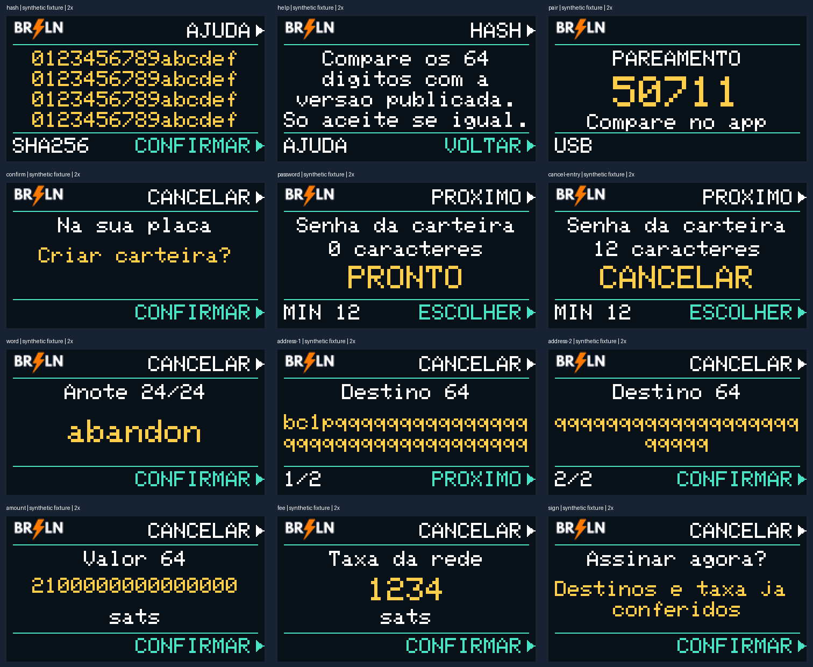

# BRLN original T-Display interface

The 240 x 135 screen uses the official BRLN mark, navy background, white text,
gold values and mint confirmation controls. Text uses a minimum 16-pixel cell
height; selected characters/words use 24 pixels and the pairing code 32 pixels.
No actionable text is reduced to the old 8-pixel font. ASCII Portuguese is used
because the embedded font does not provide reliable UTF-8 accented glyphs.

## Physical controls

With USB to the right, the upper button is GPIO35 and the lower button is
BOOT/GPIO0, matching the [manufacturer pinout](https://github.com/Xinyuan-LilyGO/TTGO-T-Display/blob/master/image/pinmap.jpg).
Labels and right-pointing arrows sit at the corresponding upper/lower edge.
They describe the action on that screen rather than internal A/B/#/* names.

- Hash: upper AJUDA opens instructions; lower CONFIRMAR approves only from the
  full-hash screen. Lower VOLTAR on help returns without approval. An unavailable
  hash cannot be approved. All 64 digits remain visible, four rows of 16.
- Local confirmation: upper CANCELAR; lower CONFIRMAR.
- Character/option entry: upper PROXIMO cycles options; lower ESCOLHER selects.
  PRONTO finishes, APAGAR removes a character and CANCELAR abandons entry. The
  password remains hidden; the screen shows its length and MIN 12 requirement.
- Pairing: compare the code with the browser. No physical approval is implied.
- Transaction review: upper cancels on every page. Lower advances every full
  address page, then confirms its separate value screen. Fee and final signing
  remain separate physical approvals. No address character is abbreviated.
- Public address/xpub: upper PAGINA changes text page; lower QR/TEXTO toggles
  display. QR modules occupy the left square; actions occupy the right rail.
- Long informational messages: upper MAIS changes page. These pages are not
  transaction approvals and cannot advance a physical review.

The cryptographic protocol and host secret restrictions are unchanged. Local
wallet entry still uses physical button events exclusively. Extra review pages
can take more button presses, deliberately preserving complete address review.

## Render and regression checks

`tests/brln_ui_render.cpp` executes the **production** `202_brln_ui.ino` against a
host framebuffer, using the same embedded font and RGB565 logo. Fixtures are
synthetic and contain no wallet information. It asserts text bounds and minimum
font size, failed-hash behavior, help navigation, rejection on each address page
and full traversal before acceptance. It checks maximum amounts and all printable
ASCII input characters. This is not hardware/button or cryptographic validation.

```sh
mkdir -p artifacts
g++ -std=c++17 -Wall -Wextra -Werror -I tests/host tests/brln_ui_render.cpp -o artifacts/brln-ui-render
./artifacts/brln-ui-render
python tools/render_brln_ui_preview.py
```

The preview assembler requires Pillow. The firmware CI runs the native renderer
in addition to policy, entropy, input, cryptographic and package tests.



Physical inspection of the hash screen is possible before approval. Pairing,
password entry, recovery and signing on the new firmware still require the
owner's physical interaction; host renders must not be reported as those tests.
