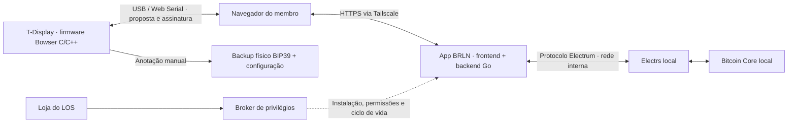

# [0.5.45] App BRLN Hardwallet: Bowser via Web Serial, backend Go e Electrs local, integrado ao broker

## Problema e resultado esperado

Permitir que o membro use uma LILYGO T-Display original como assinador Bitcoin, abrindo um app pela loja do LightningOS. O dispositivo se conecta por USB ao computador do membro; o navegador prepara a transação, solicita revisão/assinatura física e transmite o resultado usando o node próprio. O LOS hospeda a interface e fornece dados da blockchain, sem receber seed, chave privada ou passphrase.

Exemplo: o membro abre o app por HTTPS via Tailscale, conecta a T-Display ao seu computador, escolhe UTXOs e destinatário, confere os dados completos na placa e confirma pelos botões. O navegador valida a transação assinada antes do broadcast. O broker gerencia instalação e ciclo de vida; não participa da assinatura.

**Status:** especificação para desenvolvimento. Firmware BRLN ainda não implementado/validado; não apresentar o app como pronto para custodiar fundos. O desenvolvimento da integração LOS pode avançar com dispositivo simulado e carteira pública descartável. A liberação do fluxo real depende dos critérios desta issue e do firmware.

## Base e organização do trabalho

- Alvo de planejamento: linha **0.5.45-Beta**. A branch local de referência encontrada foi `agent/0.5.45-release`, commit `15db737be9c2d333723a207bd8150e34a306f16f`. Não assumir que uma branch literalmente chamada `0.5.45` exista; confirmar a ponta de integração na sessão responsável antes de implementar. A sessão ativa de melhorias LOS não deve ser sobrescrita.
- Upstream Bowser analisado: [lnbits/hardware-wallet, commit 1a260517](https://github.com/lnbits/hardware-wallet/tree/1a260517ea3b99f9c52c98b7cde4f7498e7ec789). Licença raiz MIT; preservar atribuições e licenças das bibliotecas.
- Hardware confirmado pelo proprietário: **três T-Display originais**, ESP32, tela 1,14″/240 × 135, dois botões. Não é S3. A placa não possui microSD integrado; começar com USB, sem câmera e sem teclado adicional.
- Firmware, frontend do app e adaptador devem ter artefatos versionados em projeto próprio. No LOS ficam catálogo, manifesto, broker, configuração de integração e UI da loja. Nome/ID proposto: `brln-hardwallet`; conferir colisões antes de reservar porta, UID/GID e diretórios.
- Não há fork remoto BRLN publicado neste momento. Não inventar endereço de imagem GHCR ou digest: esses artefatos são dependência da implementação.

## Arquitetura

- Web Serial atua no computador que executa o navegador. Não passar `/dev/ttyUSB*` para o container e não ligar a placa ao servidor para este fluxo.
- Backend em **Go** para API limitada, cliente Electrum, saúde, configuração e serviço de arquivos estáticos. Frontend Svelte/TypeScript reaproveita o webapp upstream. O manager LOS continua com sua UI React e seus padrões de integração.
- Manter montagem/validação de PSBT no cliente com bibliotecas existentes. O backend não gera chaves, assina nem precisa de credenciais do Core/LND.
- Não reescrever o firmware em Go nesta entrega. TinyGo tem suporte a ESP32, mas isso não demonstra compatibilidade com o conjunto de drivers/bibliotecas do Bowser. Portar exigiria revalidar tela, botões, serial, RNG, flash, consumo de memória e criptografia. Fonte: [TinyGo ESP32 Core board](https://tinygo.org/docs/reference/microcontrollers/boards/esp32-coreboard-v2/). Manter um fork pequeno facilita incorporar correções upstream.
- USB conectado não é air gap. Tailscale fica entre navegador e node; não roda na placa.

## Evidências do upstream e dependências de firmware

No commit fixado:

- `wallet/boards/lilygo_tdisplay/profile.h`: botões GPIO 0/35, perfil com suporte a teclado/SD opcional. Criar perfil explícito sem acessórios no fork; não assumir que `hasMatrixKeypad` representa hardware realmente conectado.
- `wallet/717_cmd_restore.ino`: restauração recebe senha e mnemônico do host. `wallet/713_cmd_password_check.ino`: desbloqueio/passphrase também vêm do host. **Ocultar formulários no frontend não elimina esses caminhos.**
- `wallet/723_cmd_create.ino`: entrada de 100 dados pressupõe teclado/touch; implementar seleção 1–6 com dois botões e recuperação BIP39 local com correção/cancelamento.
- `wallet/719_show_seed.ino`: exibe palavras na tela, sem devolvê-las na resposta serial normal. Revisar todos os outros caminhos e logs antes de afirmar ausência de vazamento.
- `wallet/718_cmd_sign_psbt.ino`: revisão física de saídas e taxa já existe; validar que todos os dados assinados correspondam ao que foi mostrado.
- `webapp/README.md`, `webapp/src/lib/mempool.ts` e `storage.ts`: frontend atual usa API compatível com Mempool e defaults públicos. **Não basta inserir `127.0.0.1:50001` como URL.** Navegador não fala Electrum TCP diretamente.

Contrato do fork a fechar entre as duas sessões: versão do protocolo, rede, tipo de conta, limite de PSBT, capacidades de recuperação local, revisão física e erros estáveis. App deve rejeitar fluxos incompatíveis com mensagem acionável. Uma versão ou hash autoafirmado pela placa não é prova de integridade; a compatibilidade não substitui verificação do firmware.

Não habilitar restauração por texto, senha de carteira ou passphrase no navegador. Senha de autenticação do app é outro segredo e segue o padrão LOS. O acesso do app à seed é proibido por projeto, incluindo suporte, telemetria e logs. Tratamento de credenciais locais, persistência cifrada versus modo temporário, backup e inicialização ficam no firmware. Não alterar requisitos do RNG para simplesmente desabilitar rádios.

## Escopo funcional do primeiro app

1. Instalar/abrir/parar/iniciar/atualizar/remover pelo padrão da loja. Exibir versão do app, estado do backend e disponibilidade/sincronização do Electrs separadamente.
2. Diagnóstico de navegador, contexto seguro, permissão serial, dispositivo e protocolo. Conectar exige ação do usuário. Tratar cancelamento do seletor, cabo removido, porta ocupada, timeout e reconexão.
3. Importar apenas configuração pública: xpub/descritor, fingerprint, rede, derivação e tipo de script. Validar coerência e permitir exportação para recuperação; preservar cursores de recebimento/troco. Inicialmente **single-sig SegWit nativo BIP84**; demais tipos exigem ensaio próprio antes de habilitar.
4. Receber: derivar endereço e conferir o endereço completo na placa. Histórico, saldo, UTXOs e seleção de moedas via backend local.
5. Enviar: montar PSBT, mostrar taxa absoluta e sat/vB, destinatário, troco e UTXOs. Revisão e aprovação físicas na placa são obrigatórias. Validar assinaturas e identidade da transação retornada antes de finalizar/transmitir; nenhuma alteração silenciosa de saídas.
6. Separar estados: preparada → enviada ao dispositivo → aguardando revisão → assinada → transmitida. Cancelamento/erro não implica envio. Uma falha de rede após broadcast exige consultar txid antes de repetir; reconectar USB não reenvia automaticamente um pedido de assinatura.
7. Orientações de backup e recuperação com dados didáticos. Não incluir campo para palavras reais nem exportação de seed. Preservar formatos abertos para operar também fora do LOS.

Persistir configuração pública no navegador inicialmente, com exportação explícita e aviso de que limpar dados do site perde esse estado. Xpubs e endereços revelam informações financeiras; não logar payloads nem enviá-los a serviços do clube. O node observará as consultas necessárias para servir sua própria carteira.

Fora do MVP: financiamento de canais LND por PSBT, multisig, uso da chave Nostr, servidor de recuperação, Wi-Fi/Bluetooth no assinador, assinatura pelo backend e instalação automática de firmware quando o app atualiza. Flasher pode ser entrega separada, com gesto explícito, verificação de artefato e respeito à carteira existente.

## Backend Go e Electrs

Contrato sugerido, pertencente ao **app**, não necessariamente a rotas públicas do manager:

| Operação | Dados e comportamento |
| --- | --- |
| Configuração/saúde | Versões do app/protocolo, rede, estado do indexador; não expor credenciais |
| Histórico/saldo/UTXOs | Script hashes validados, paginação/limites, confirmação explícita e cache controlado |
| Transação | Txid validado, dados necessários à PSBT e conferência |
| Taxas | Unidade explícita; tratar estimativa indisponível sem fallback público automático |
| Broadcast | Transação já assinada, tamanho limitado, resposta txid/erro estável, autenticação e proteção de mutação |

Usar métodos Electrum permitidos para cada operação, timeouts, limites de lote/resposta, cancelamento e reconexão. Validar rede pelo servidor e pelos dados da carteira. Não oferecer `method`/`params` arbitrários, shell, URL de upstream fornecida por requisição ou cliente RPC genérico ao navegador. Não tratar toda API Mempool como traduzível mecanicamente para Electrum: criar uma interface de provedor no frontend e mapear apenas as operações usadas, com testes das unidades, paginação, UTXOs pendentes e histórico.

O LOS já possui `internal/electrs/client.go` com transporte reutilizável como referência, mas seus pacotes `internal` não podem ser importados diretamente por um módulo externo. Avaliar extração lícita de componente ou cliente limitado no app, com testes e licença preservada; não expandir o manager para custodiar carteiras.

**Rede interna:** o manifesto atual do Electrs publica `50001` no loopback do host. `127.0.0.1` dentro do app é o próprio container, e `host.docker.internal` não torna um listener de loopback acessível automaticamente. Preferir ligação explícita do adaptador à rede Docker do Electrs, acessando seu serviço interno, sem conectar o app à rede do Bitcoin Core. Resolver criação/remoção/reattach pelo broker e testar que rede compartilhada não seja removida pelo uninstall. A alteração não deve expor 50001 na LAN/internet nem exigir Tailscale Serve para Electrs neste desenho: Tailscale transporta o HTTPS do app. Mempool local é alternativa de ensaio, não dependência obrigatória do MVP.

Electrs ausente, parado ou indexando deve produzir orientação clara; não instalar automaticamente outro app nem trocar para servidor público. O servidor comunitário é uma opção futura explícita, com privacidade e transporte definidos separadamente.

## Integração obrigatória com catálogo e broker LOS

Referências verificadas na base 0.5.45 (prefixo `lightningos-light/`):

| Camada | Referências / alterações esperadas |
| --- | --- |
| App handler | `internal/server/apps_brln_community.go` como padrão; novo handler `apps_brln_hardwallet.go`, registro em `apps_registry.go` |
| Manifesto | `internal/appmanifest/brln_community.go`, `catalog.go`, `security_inventory_test.go`; definir imagens por digest, variantes, compose, porta sem colisão, UIDs/GIDs e volume próprio |
| Ponte ao broker | `internal/system/system.go`; wrappers tipados de status/ensure/lifecycle/remove/firewall |
| Protocolo | `internal/privileged/protocol.go`, `client.go`, `broker.go`; operações tipadas, validação estrita, dispatch e allowlists |
| Execução privilegiada | `internal/privileged/brln_community.go` e `runtime_linux.go` como referências; manager próprio, caminhos fixos, permissões e lifecycle idempotentes |
| Imagens | Integrar `app.image.prepare/status/probe` e allowlists; não aceitar referência de imagem arbitrária enviada pelo cliente |
| UI/API | `ui/src/pages/AppStore.tsx`, `ui/src/api.ts`, traduções; `internal/server/routes.go` e `auth.go` se houver endpoints novos; atualizar `docs/03_API_SPEC.md` |

Nomes das novas operações devem seguir a convenção existente; não reutilizar operação do Community para executar ações de outro app. Broker indisponível/incompatível deve falhar com clareza, sem fallback para `sudo`, shell ou Docker executado pelo manager web. Atualizar composição das dependências do broker e seus testes, não apenas o dispatch.

Container do app: usuário não-root, filesystem read-only quando possível, `cap_drop: ALL`, `no-new-privileges`, tmpfs limitado, healthcheck e recursos definidos. Sem socket Docker, modo privilegiado, USB host, mounts do LND, macaroon admin, cookie RPC do Bitcoin ou `secrets.env`. Sem permissão de assinar/gastar do node. Credenciais da sessão/proxy são específicas do app e nunca confundidas com seed.

Instalação e upgrade devem fixar artefato/digest e falhar se a imagem não existir ou não rodar na arquitetura. Prever amd64 e arm64 de acordo com as plataformas realmente suportadas; cross-build não substitui teste em runtime. Não incluir um catálogo apontando para imagens fictícias.

Remoção preserva configuração/dados próprios conforme padrão LOS e nunca remove Electrs, blockchain, volumes de outros apps ou carteiras do navegador. Limpeza destrutiva, se oferecida depois, deve ser operação específica. Restart do LOS não gera reset do dispositivo. Snapshot/config-hash do proxy deve provocar recriação quando configuração muda, seguindo o padrão existente.

## HTTPS, autenticação e Tailscale

- Tailscale é o transporte adotado pelo clube, mas Web Serial exige contexto seguro no navegador. Validar certificado confiável, `window.isSecureContext` e `navigator.serial`; não documentar clique em exceção de certificado como garantia suficiente.
- Usar o padrão de proxy/auth vigente do LOS, incluindo sessão, CSRF e autorização de endpoints de mutação; não copiar sem revisão as exceções públicas do chat Nostr. Backend não deve ser acessível por uma porta alternativa sem autenticação.
- Preferir origem própria do app, sem iframe. Política de permissões serial restrita; CSP fechada, dependências servidas localmente, sem scripts/CDN de terceiros. Verificar CORS/Origin, CSP, WebSocket se usado e headers do proxy.
- Integração de certificado/Tailscale deve preservar serviços Serve existentes. Não executar `tailscale serve reset`, não ativar Funnel e não alterar ACLs da tailnet automaticamente. Definir se usará certificado já confiável do LOS ou hostname HTTPS Tailscale com configuração explícita; documentar teste em Chrome/Edge no computador real.
- Configurações de servidor público, se futuramente habilitadas, exigem escolha explícita e persistente; falha local nunca deve vazar consultas por fallback silencioso.

## Plano de entrega e critérios de aceite

- [ ] **Contrato e baseline:** fixar commits, licenças, protocolo/capacidades, ID/portas/UIDs, escopo de rede e contas. Executar testes existentes antes de alterações; registrar falhas prévias.
- [ ] **App isolado:** frontend adaptado e backend Go com provedor Electrum, dispositivo simulado e vetores públicos. Geração/restore de seed pelo host indisponíveis por design.
- [ ] **Broker completo:** operações tipadas, validação estrita, permissões, catálogo de imagens, probe e lifecycle; sem execução privilegiada fora do broker.
- [ ] **Instalação de laboratório:** instalar/iniciar/parar/reiniciar/atualizar/remover/reinstalar, dependências ausentes, portas ocupadas, permissões erradas, queda de rede, operação interrompida e rollback, preservando outros apps.
- [ ] **Fluxo navegador/dispositivo:** HTTPS+Tailscale real, permissão serial, desconexão/reconexão e rejeição por botão; endereço completo, saídas/troco/taxa, transação retornada e broadcast conferidos.
- [ ] **Segredos e abuso:** logs/traces/browser storage não contêm seed/passphrase/senha da carteira; rejeitar payloads excessivos, upstream arbitrário, CSRF, origem inválida, requisições sem auth e protocolo incompatível.
- [ ] **Recuperação:** carteira descartável restaurada em segunda placa e em outra implementação compatível; endereços de recebimento/troco e capacidade de assinar conferidos. Três placas iguais não comprovam diversidade de fabricante.
- [ ] **Gate de release:** firmware com recuperação local e revisão física validado. Caso incompleto, manter implementação em PR draft/ambiente de desenvolvimento, sem anunciar custódia pronta no catálogo de produção.

Validação LOS: `go test ./internal/server -run TestValidateAppRegistry`, testes relevantes de `internal/appmanifest`, `internal/privileged` e `internal/system`, depois `go test ./...`, `go vet ./...` e `npm run build` da UI. No app: testes Go, testes/check/build do webapp e fluxo em navegador. Testes de protocolo/assinatura devem verificar invariantes e falhas, não apenas reproduzir a implementação.

Se os caminhos compartilhados de instalação/upgrade forem afetados, validar `install.sh`, `install_existing.sh`, `install_existing_pi.sh` e atualização pela UI a partir de instalação anterior, conforme `AGENTS.md`. Testar em Linux descartável e arquiteturas suportadas. LOS é mainnet-only; laboratório regtest deve ser separado, sem mudar a rede de node de produção. Nenhum fundo real como fixture.

Esta issue não autoriza nem depende de publicar um release nesta sessão. Respeitar a ponte 0.5.40: desenvolvimento/issues permanecem em `jvxis/brln-os-light`, releases acima de 0.5.40 seguem `jvxis/brln-os-light-updates`, conforme `AGENTS.md` e `docs/MANDATORY_0.5.40_CATALOG.md`. Não prometer inclusão na 0.5.45 antes dos gates de validação.

## Fontes para a sessão de implementação

- [Base LOS inspecionada](https://github.com/jvxis/brln-os-light/tree/15db737be9c2d333723a207bd8150e34a306f16f) e seu `AGENTS.md`.
- [Bowser fixado no commit de referência](https://github.com/lnbits/hardware-wallet/tree/1a260517ea3b99f9c52c98b7cde4f7498e7ec789).
- [Web Serial: contexto seguro e permissões](https://developer.mozilla.org/en-US/docs/Web/API/Web_Serial_API).
- [Tailscale: certificados HTTPS](https://tailscale.com/docs/how-to/set-up-https-certificates).
- [TinyGo: suporte ESP32](https://tinygo.org/docs/reference/microcontrollers/boards/esp32-coreboard-v2/).

Especificação elaborada em 14/10/2026 por leitura de código e documentação. Não houve implementação, compilação, operação de produção ou teste de hardware nesta etapa.
